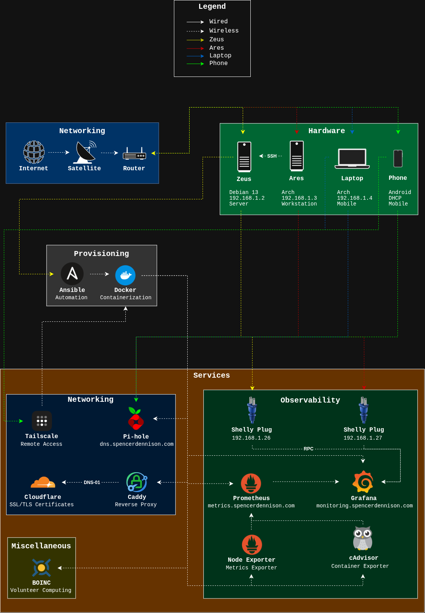
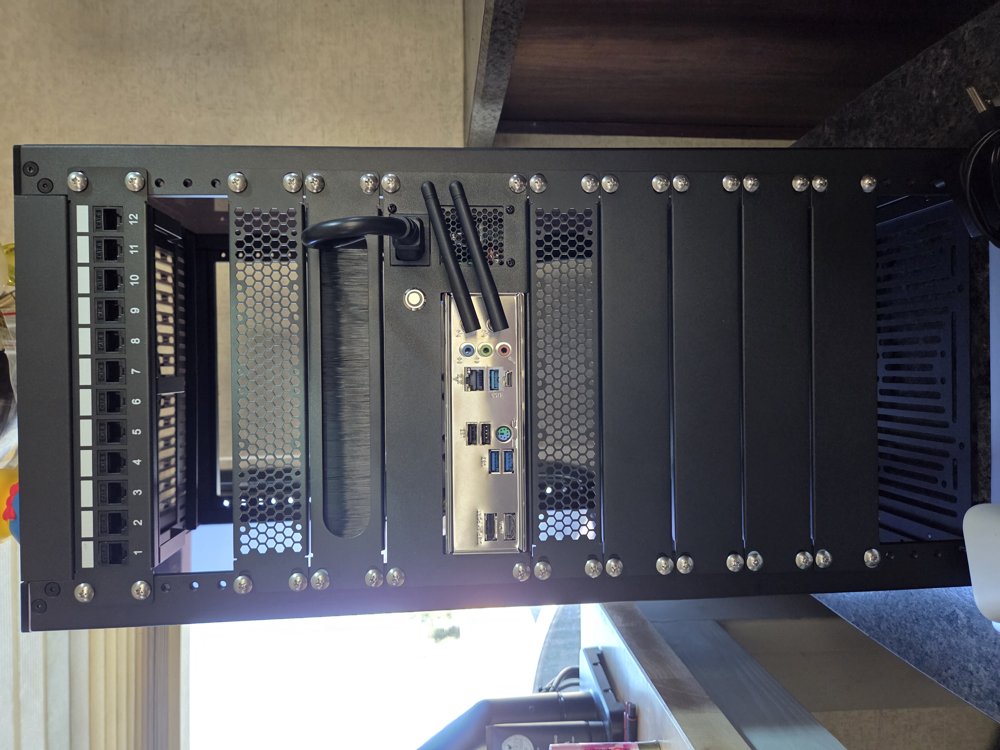

# zeus

Configuration for my server.

## Table of Contents   

* [Pre-Installation](#pre-installation)
* [Installation](#installation)
* [Post-Installation](#post-installation)
* [Architecture](#architecture)
* [Rack](#rack)

## Pre-Installation

- Add Cloudflare DNS record pointing to server
- Install Debian on server

## Installation

Update and upgrade apt package repository

```bash
sudo apt update && sudo apt upgrade
```

Install Ansible and Git

```bash
sudo apt install ansible git
```

Clone repository

```bash
git clone https://github.com/spencerdennison/zeus.git
```

Change directory to zeus

```bash
cd zeus
```

Run Ansible playbooks

```bash
./scripts/provision.sh
```

## Post-Installation

- Briefly Allow SSH to server using password, ensure to revert

Copy SSH key from control device to server

```bash
ssh-copy-id -i ~/.ssh/key.pub administrator@zeus.spencerdennison.com
```

Add server to Tailscale network

```bash
sudo tailscale up
```

Reboot server

```bash
sudo reboot
```

## Architecture



## Rack


